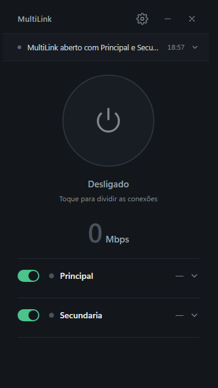

# MultiLink Balancer

App para Windows que soma várias conexões de internet (cabeadas, Wi-Fi ou 4G via USB) usando o
próprio PC: cada link tem seu gateway e o app distribui o tráfego entre eles. É um `.exe` único
(~13 MB, quase tudo do tun2socks usado na captura), sem instalação, com a interface em Svelte rodando no WebView2 que já vem no Windows 11.



## Como usar

A janela é compacta e vertical, sem a barra de título do Windows: arraste pelo topo (onde está o nome\nMultiLink) e use os botões de minimizar e fechar ao lado da engrenagem. A tela inicial tem só o essencial:

- **Faixa de eventos** (topo): o último evento; clique para ver os anteriores.
- **Botão I/O**: liga e desliga o MultiLink. Ligado, o proxy local sobe em `127.0.0.1:1080`
  (SOCKS4, SOCKS5 e HTTP) e, por padrão, o Windows passa a usar o balanceamento. Ao desligar ou sair,
  a configuração anterior do Windows volta.
- **Total** recebido agora e **os links**: o interruptor à esquerda ativa ou desativa o adaptador no
  Windows (pode pedir confirmação de administrador); clicar no link mostra endereço, latência,
  velocidade medida, conexões e o peso.
- **Engrenagem**: download acelerado e ajustes (distribuição, quedas, inicialização, sair).

Na primeira execução o app mede a velocidade de cada link e ajusta os **pesos**.

Fechar a janela mantém o app na bandeja (monitorando quedas). Para encerrar: **Sair** no menu do
ícone da bandeja ou em Ajustes. Abrir o `.exe` de novo traz a janela de volta.

## Como a soma funciona

| Situação | Soma os links? |
|---|---|
| Navegador, speedtest, vários downloads, Steam, torrent via SOCKS5 | **Sim**: cada conexão sai por um link, na proporção dos pesos |
| Um arquivo pelo *Download acelerado* (engrenagem) | **Sim**: o arquivo é dividido em partes (HTTP Range) baixadas pelos links em paralelo |
| Uma única conexão (um stream, um download comum de 1 conexão, jogo online) | **Não**: uma conexão TCP sai por um link só |
| Tráfego UDP (jogos, chamadas de voz/vídeo, QUIC) | Só com *Capturar todos os programas*: cada fluxo sai por um link (balanceia, não soma) |

Somar tudo, inclusive uma conexão única e o upload, exige um servidor externo (VPS) que junte os
links (bonding), como Speedify ou OpenMPTCProuter. Isso não dá para fazer só do lado do PC.

## Ajustes

- **Peso**: proporção de conexões por link. Use *Medir velocidade e ajustar pesos* (ex.: 719 Mbps → 72,
  94 Mbps → 9). Pesos iguais em links de velocidades muito diferentes deixam a soma **mais lenta**.
  Peso 0 = não usar.
- **Distribuição**: *Proporcional aos pesos* (padrão), *Menos conexões*, *Só um link, com reserva* ou *Menor latência*
  (usa o link de menor ping no momento, pela média móvel; só troca quando outro fica claramente mais rápido).
- **Considerar perda de pacotes e jitter** (ligado por padrão): um link que está perdendo pacotes recebe menos
  conexões até melhorar (10% de perda → cerca de 2/3 do peso; 30% ou mais → quase nada). No modo *Menor latência*,
  perda e jitter também contam, não só o ping.
- **Manter cada site no mesmo link**: ligue se algum site (banco, login) desconectar por trocar de IP.
  Com isso ligado, downloads de um mesmo site não somam os links.
- **Aceitar conexões de outros aparelhos da rede**: outros dispositivos podem usar `IP-deste-PC:1080` como proxy.

## Capturar todos os programas

Por padrão só passa pelo MultiLink o que respeita o proxy do Windows (navegadores, Store, Windows Update...).
Com **Capturar todos os programas** (Ajustes, requer administrador) o resto também passa: jogos, apps de chat,
linha de comando e tráfego UDP.

Como funciona: o [tun2socks](https://github.com/xjasonlyu/tun2socks) cria um adaptador de rede virtual
[Wintun](https://www.wintun.net) chamado **MultiLink** e entrega cada conexão TCP/UDP que chega nele ao proxy
SOCKS5 local. Duas rotas `0.0.0.0/1` e `128.0.0.0/1` (mais específicas que a rota padrão) mandam a internet
para esse adaptador; as conexões do próprio MultiLink saem presas ao IP de cada link e por isso continuam indo
direto pelos adaptadores reais. A rede local (impressoras, roteador, outros PCs) continua direta.

**IPv6**: quando algum link tem IPv6, a rota `2000::/3` (toda a internet IPv6) também vai para o adaptador, que
recebe um endereço privado (ULA). Com isso o Windows prefere IPv4 nos sites que têm os dois, e os destinos só IPv6
passam pelo MultiLink e saem pelos links que têm IPv6. Sem nenhum link com IPv6, nada muda no IPv6 do sistema.

- **Segurança**: o tun2socks roda vinculado ao MultiLink (Job Object do Windows). Se o app fechar ou travar, o
  Windows encerra o tun2socks, o adaptador some e as rotas somem junto: a internet volta ao normal sozinha.
  As rotas são criadas como temporárias (`store=active`) e não sobrevivem a um reinício.
- **DNS**: com a captura ativa, o Windows resolve nomes por 1.1.1.1 e 8.8.8.8 através do MultiLink.
- **Limitações**: um jogo ou chamada (um fluxo UDP) usa um link só;
  VPNs e alguns anti-cheats podem não conviver com o adaptador virtual.

## Histórico

O botão de gráfico na tela inicial mostra a velocidade e a latência de cada link (1 h, 6 h ou 24 h), as quedas
dos últimos 30 dias (causa e duração) e os dados recebidos por dia. Um ponto por minuto, salvo em
`%APPDATA%\MultiLinkBalancer\history.json`.

## Atalhos e bandeja

- **Ctrl+Alt+M** liga/desliga o MultiLink; **Ctrl+Alt+N** abre/fecha o painel (de qualquer programa;
  podem ser desligados em Ajustes > Avisos).
- O menu do ícone da bandeja liga/desliga, troca o modo de distribuição, inclui/retira links e mede a velocidade.

## Quedas de link

O app testa cada link a cada 3 s, mesmo com o proxy desligado, e diz **onde** está o problema:

| Estado | Significado |
|---|---|
| Sem internet (operadora) | o modem/ONT responde, mas a internet não: problema na operadora |
| Modem não responde | modem desligado, travado ou cabo com defeito |
| Cabo desconectado | sem sinal físico no adaptador |
| Desativado no Windows | adaptador desligado (pode ser reativado pelo botão **Ativar**) |

- **Aviso**: notificação do Windows + som quando um link cai ou volta. O ícone da bandeja fica vermelho
  enquanto houver link fora, e o link mostra o diagnóstico ao ser expandido.
- **Ativar/Desativar**: interruptor à esquerda de cada link, faz o mesmo que o Painel de Controle (pede confirmação do Windows/UAC).
- **Tirar link caído do roteamento do Windows** (opcional, requer administrador): quando um link cai, ele sai
  do roteamento do sistema inteiro (métrica 9000) e volta sozinho quando a internet dele retorna. Ao fechar o
  app, as rotas originais são restauradas. Como administrador, "Iniciar com o Windows" usa uma tarefa agendada elevada.

## Qualidade dos links

Além do teste a cada 3 s, cada link recebe um ping (ICMP) saindo pelo próprio endereço. Das últimas 20 respostas
(cerca de 1 minuto) saem a **perda de pacotes** e o **jitter** (variação média entre respostas seguidas), mostrados
ao expandir o link. Se a rede bloqueia ICMP, a medida usa o tempo das conexões TCP de teste (uma conexão que precisa
reenviar o pedido conta como perda). Com 10% de perda ou mais o link fica **instável**: ponto amarelo e aviso
no registro de eventos, até a perda voltar para 3% ou menos.

## Atualizações

Uma vez por dia (e 30 s depois de abrir) o app consulta a última release deste repositório no GitHub e avisa se há
versão nova. Em *Ajustes > Atualizações*, **Atualizar** baixa o `.exe`, confere o SHA-256 publicado junto com ele,
troca o executável e reinicia. A consulta usa a API pública do GitHub, então só funciona com o repositório público.

## Memória

Medido nesta máquina (memória privada):

| Situação | Uso |
|---|---|
| Na bandeja (WebView2 é destruído) | ~29 MB |
| Janela aberta (app + WebView2, renderização por software) | ~131 MB |

## Estrutura

```
src/                 núcleo e janela (C#, .NET Framework 4.x)
  Core.cs            proxy SOCKS/HTTP, balanceador, health check, monitor de quedas, download em partes
  AppCore.cs         estado e comandos do app (sem interface)
  HostForm.cs        janela + WebView2 + bandeja; ponte de mensagens com a UI
  Program.cs         inicialização, instância única, extração das DLLs do WebView2
  Capture.cs         captura de todos os programas (tun2socks + Wintun, IPv4 e IPv6)
  History.cs         histórico de velocidade, latência e quedas
  Updater.cs         atualização pelo GitHub Releases
ui/                  interface (Svelte 5 + Vite)
  src/lib/bridge.js  ponte com o C# via chrome.webview.postMessage (sem servidor HTTP)
  src/lib/mock.js    simulador para desenvolver no navegador
lib/webview2/        DLLs oficiais do pacote NuGet Microsoft.Web.WebView2 1.0.4258.31
lib/tun2socks/       tun2socks 2.7.0 (MIT) e wintun.dll 0.14.1 (assinado pela WireGuard LLC), sem modificações
```

A UI não abre nenhuma porta: ela conversa com o C# pelo canal interno do WebView2, e só aceita
mensagens da própria origem (`https://app.multilink`). O HTML vem embutido no `.exe`.

## Desenvolver

```powershell
cd ui
npm run dev          # http://localhost:5173 com dados simulados e hot reload (use uma janela de 360x640)
```

Para ver a UI em desenvolvimento dentro do app real (com dados reais), abra o app com a variável
`MULTILINK_DEV_URL=http://localhost:5173` (o DevTools fica habilitado nesse modo).

## Compilar

```powershell
./build.ps1            # front + app
./build.ps1 -SkipUi    # só o C#
```

Usa o `csc.exe` do .NET Framework (já incluído no Windows) e Node.js para o front. A versão gravada no `.exe`
vem da última tag `vX.Y.Z` do git (ou de `-Version 1.2.3`).
As configurações ficam em `%APPDATA%\MultiLinkBalancer\config.ini`.
